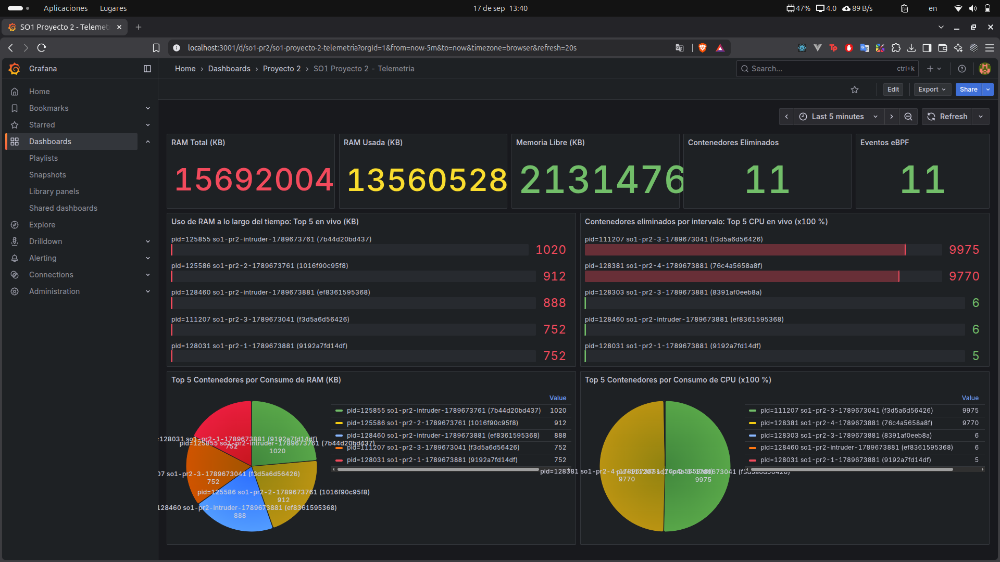
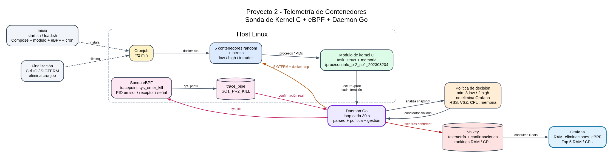

# Evidencias funcionales - Proyecto 2

**Curso:** Sistemas Operativos 1  
**Carnet:** 202303204  
**Fecha de prueba:** 17/09/2026

## 1. Interfaz `/proc`

La salida observada de `/proc/continfo_pr2_so1_202303204` incluyó:

```text
MEM_TOTAL_KB:15692004
MEM_FREE_KB:2216208
MEM_USED_KB:13475796
PID,NAME,CMD_OR_CONTAINER_ID,VSZ_KB,RSS_KB,MEM_PCT,CPU_PCT,CLASS
```

El listado contiene procesos del sistema y procesos creados por los contenedores, junto con PID, nombre, comando, VSZ, RSS, porcentaje de memoria y porcentaje de CPU.

## 2. Cronjob y eBPF

La salida de la terminal confirmó:

```text
*/2 * * * * /bin/bash .../Proyecto2/cronjob/spawn_containers.sh # proyecto2-so1
1: perf_event prog 900
    tracepoint sys_enter_kill
```

Esto demuestra que el daemon instala el cronjob cada dos minutos y que la sonda está adjuntada al tracepoint `sys_enter_kill`.

## 3. Flujo de eliminación

Durante la prueba se observaron líneas como:

```text
SIGTERM enviado por el daemon pid=125768 nombre=so1-pr2-4-1789673761
contenedor confirmado por eBPF pid=125768 signal=15 sender=120002
contenedor detenido pid=125768 nombre=so1-pr2-4-1789673761 clase=high
contenedor eliminado id=...
```

La misma secuencia se observó para varios contenedores `high`. El PID confirmado por eBPF coincide con el PID al que el daemon envió la señal.

Los contenedores `high` de CPU permanecieron activos hasta ser seleccionados por la política. La imagen `go-client` se verificó posteriormente en estado `running` con consumo de memoria residente, mientras que las ejecuciones anteriores que muestran `Exited (2)` corresponden a una versión previa de la imagen.

## 4. Grafana

La captura `images/04-grafana-dashboard.png` muestra:



- RAM total: `15692004 KB`.
- RAM usada y memoria libre del host.
- `Contenedores Eliminados: 11`.
- `Eventos eBPF: 11`.
- Top 5 de contenedores por RAM con PID, nombre e ID Docker.
- Top 5 de contenedores por CPU con PID, nombre e ID Docker.
- Gráficas de barras y pie charts funcionando.

No se requieren capturas adicionales de Grafana; el dashboard completo concentra la evidencia visual.

El valor de `Eventos eBPF` coincide con las eliminaciones confirmadas. Los valores de CPU cercanos a `10000` representan aproximadamente 100% porque el daemon almacena el porcentaje con dos decimales multiplicado por 100.

El detalle ampliado de rankings y contadores se conserva en `images/04-grafana-dashboard.png`, que es la única captura necesaria de Grafana para la entrega.

## 5. Resultado



La prueba valida el flujo completo:

```text
cronjob -> contenedores Docker -> módulo /proc -> daemon Go
-> decisión por umbral -> SIGTERM -> sys_kill/eBPF
-> confirmación -> Valkey -> Grafana
```

El cronjob genera tres contenedores `low` y dos `high` por lote, mientras la política conserva esos mínimos y nunca selecciona Grafana.
